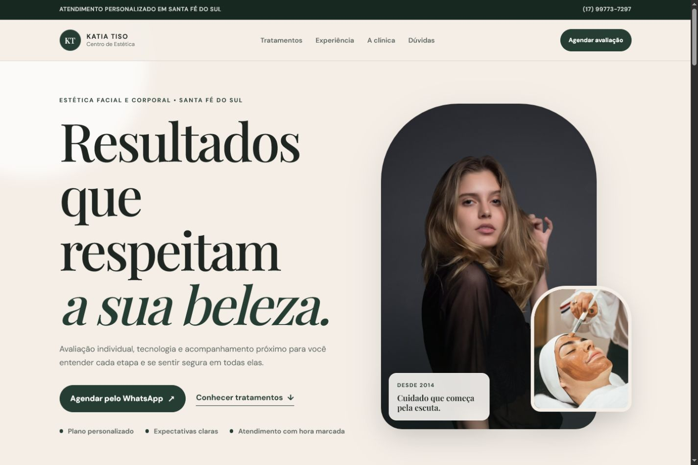

# Centro de Estética Katia Tiso

Landing page premium, responsiva e orientada à conversão para o Centro de
Estética Katia Tiso, em Santa Fé do Sul — SP.

O projeto conduz a visitante da apresentação dos tratamentos até o atendimento
no WhatsApp com clareza, baixo atrito e uma experiência mobile-first.

## Prévia



## Destaques

- hero editorial com proposta de valor e CTA principal acima da dobra;
- tratamentos organizados por objetivo, facilitando a escolha inicial;
- formulário com apenas duas seleções e sem coleta de dados pessoais;
- mensagem de WhatsApp montada automaticamente com interesse e período;
- CTA fixo no mobile após a primeira rolagem;
- jornada de atendimento, pilares de confiança, localização e FAQ;
- captura de parâmetros UTM para integrações futuras;
- conteúdo renderizado progressivamente, sem depender de framework;
- animações leves com suporte a `prefers-reduced-motion`;
- SEO local e dados estruturados com Schema.org.

## Estratégia de conversão

O fluxo foi desenhado para reduzir dúvidas antes do contato:

1. A visitante entende a proposta da clínica no hero.
2. Conhece os tratamentos por objetivo, sem precisar decidir um protocolo.
3. Seleciona o que deseja cuidar e o melhor período.
4. Continua no WhatsApp com uma mensagem já preenchida.

Quando não há endpoint configurado, todo o fluxo continua funcionando pelo
WhatsApp. Caso um backend seja adicionado, o mesmo formulário também pode
registrar o lead em uma API, CRM ou automação.

## Stack

Projeto estático e sem dependências de build:

- HTML5 semântico;
- CSS responsivo e mobile-first;
- JavaScript com ES Modules;
- Google Fonts;
- integração com WhatsApp via `wa.me`;
- mapa incorporado do Google Maps.

## Estrutura

```text
landing-page-clinica-estetica/
├── assets/
│   └── landing-page-preview.png
├── scripts/
│   ├── components.js
│   ├── config.js
│   ├── main.js
│   └── site-data.js
├── styles/
│   └── main.css
├── AGENTS.md
├── index.html
├── README.md
└── serve.ps1
```

### Arquivos principais

| Arquivo | Responsabilidade |
| --- | --- |
| `index.html` | Estrutura, SEO, conteúdo institucional e formulário |
| `styles/main.css` | Identidade visual, layout, responsividade e animações |
| `scripts/site-data.js` | Tratamentos, jornada, diferenciais e perguntas frequentes |
| `scripts/components.js` | Templates dos componentes renderizados por JavaScript |
| `scripts/main.js` | Renderização, WhatsApp, formulário, UTM, FAQ e microinterações |
| `scripts/config.js` | Número do WhatsApp e configuração opcional de backend |

## Como executar

O site usa módulos ES e deve ser servido por HTTP. Não abra o `index.html`
diretamente com `file://`, pois o navegador pode bloquear os módulos.

### Script do projeto

Na raiz do repositório:

```powershell
powershell -ExecutionPolicy Bypass -File .\serve.ps1
```

Depois, acesse [http://localhost:5500](http://localhost:5500).

Para usar outra porta:

```powershell
powershell -ExecutionPolicy Bypass -File .\serve.ps1 -Port 8080
```

### Servidor do Python

```powershell
python -m http.server 5500
```

Também é possível utilizar extensões como Live Server.

## Personalização

### Conteúdo e tratamentos

Edite `scripts/site-data.js` para alterar:

- serviços e destaques;
- etapas da experiência;
- pilares de confiança;
- argumentos de autoridade;
- perguntas frequentes.

### WhatsApp

O número é configurado em `scripts/config.js` no formato internacional, sem
espaços ou símbolos:

```js
export const leadConfig = {
  whatsappNumber: "5517997737297",
  leadEndpoint: "",
  requestMethod: "POST",
  requestHeaders: {
    "Content-Type": "application/json"
  }
};
```

Os textos específicos de cada CTA ficam nos atributos `data-message` do HTML e
nos objetos de serviço em `scripts/site-data.js`.

### Integração com backend

Defina `leadEndpoint` para registrar o contato em uma API ou CRM. O payload
atual segue este formato:

```json
{
  "interest": "Tratamentos faciais",
  "schedule": "Tarde",
  "utm_source": "",
  "utm_medium": "",
  "utm_campaign": "",
  "utm_content": "",
  "utm_term": "",
  "source": "landing-page",
  "businessName": "Centro de Estética Katia Tiso",
  "sentAt": "2026-08-03T12:00:00.000Z"
}
```

O WhatsApp é aberto antes da chamada opcional ao backend, evitando que uma
falha externa impeça o contato.

### Imagens

As imagens editoriais são carregadas pelo Unsplash. Para produção, recomenda-se
substituí-las por fotos reais da clínica, equipe e procedimentos e hospedá-las
localmente em formatos otimizados como WebP ou AVIF.

## Acessibilidade e experiência

- link para pular diretamente ao conteúdo;
- marcação semântica e hierarquia de títulos;
- foco visível em controles interativos;
- áreas de toque adequadas para celular;
- formulário associado a rótulos e validação nativa;
- mensagens de status com `aria-live`;
- respeito à preferência de movimento reduzido;
- navegação e CTAs utilizáveis por teclado.

## Performance

- sem framework ou bundle de JavaScript;
- scripts organizados em módulos nativos;
- imagens abaixo da dobra com carregamento tardio;
- mapa carregado com `loading="lazy"`;
- animações baseadas em `IntersectionObserver`;
- componentes renderizados a partir de dados centralizados.

## Checklist de publicação

- [ ] substituir as imagens editoriais por fotos aprovadas da clínica;
- [ ] confirmar telefone, endereço, tratamentos e textos finais;
- [ ] testar o fluxo completo em um celular real;
- [ ] revisar a mensagem de cada CTA do WhatsApp;
- [ ] comprimir e hospedar as imagens localmente;
- [ ] configurar analytics e eventos de conversão;
- [ ] configurar o endpoint de leads, se necessário;
- [ ] validar SEO, acessibilidade e desempenho após a publicação.

## Licença

Uso interno e comercial conforme a necessidade do projeto.
